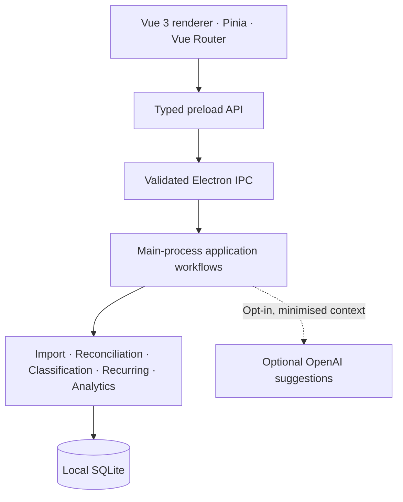

<div align="center">

# Sampo

### Personal finance, understood locally.

A macOS desktop app that turns bank statements into a clear view of spending, income, and recurring payments—with deterministic calculations and user-controlled classification.

**Electron · Vue 3 · TypeScript · SQLite · Zod · Vitest**

[Product capabilities](#what-you-can-do) · [Engineering highlights](#engineering-highlights) · [Run locally](#run-locally) · [Explore the code](#explore-the-code)

</div>

---

## Why Sampo exists

Bank exports contain the raw facts, but understanding them takes work: inconsistent formats, overlapping statement periods, cryptic merchant descriptions, and credit-card settlements that can count the same spending twice.

Sampo brings that workflow into one local desktop application: **import → review → reconcile → classify → analyse**. It combines a Vue interface with a transactional SQLite core, keeping imported financial facts separate from user decisions and optional AI suggestions.

**Status:** Working application in active development, with macOS as the first packaging target. Imports, reconciliation, categorisation, recurring-payment review, and dashboard analysis are implemented. Signed distribution and forecasting remain future work.

## What you can do

| Capability                     | Implemented workflow                                                                                                                                                            |
| ------------------------------ | ------------------------------------------------------------------------------------------------------------------------------------------------------------------------------- |
| **Import bank statements**     | Preview and import supported EVO/Bankinter account Excel/PDF and Visa XLS/PDF formats, with validation, duplicate protection, import history, and rollback.                     |
| **Reconcile card spending**    | Review a settlement against a Visa batch, confirm an exact match, and exclude the settlement from spending totals to avoid double counting. Reverse reconciliation when needed. |
| **Organise transactions**      | Search and filter transactions; manage categories, subcategories, merchants, aliases, and reusable classification rules. Manual decisions take precedence.                      |
| **Review recurring payments**  | Detect recurring candidates using deterministic cadence rules, accept or reject them, and create recurring series manually from transactions.                                   |
| **Understand cash flow**       | Explore spending, income, net cash flow, category and merchant breakdowns, monthly trends, recurring spend, and data-quality indicators, with transaction drill-downs.          |
| **Use optional AI assistance** | Review merchant and category suggestions through an opt-in OpenAI integration. Suggestions remain separate from financial facts and require confirmation.                       |

## Engineering highlights

### Financial correctness as a domain constraint

Amounts are stored as **integer cents** and dates as ISO `YYYY-MM-DD`. Reconciliation requires exact signed equality between a settlement and the eligible completed movements in a Visa batch; it does not use fuzzy amounts or subset matching. Refunds contribute their signed value, while pending movements are excluded.

Successful reconciliation creates explicit links from the settlement to each Visa movement. Commit and reversal are atomic, and active links prevent unsafe import rollback.

→ [Reconciliation service and tests](src/main/reconciliation/) · [Money utilities](src/main/domain/money.ts)

### Resilient ingestion of imperfect source formats

Format-specific adapters produce a shared validated import model. PDF parsing reconstructs rows from positioned text, while account PDF validation checks running balances across page boundaries. File hashes and account-scoped transaction fingerprints protect against duplicate files and overlapping imports.

Preview does not write to the database. Commit revalidates the source and writes the batch atomically, so failed imports leave no partial transactions.

→ [Import adapters and tests](src/main/importers/) · [Import service](src/main/services/import-service.ts)

### Explicit desktop security boundaries

The renderer handles presentation; the Electron main process owns filesystem access, SQLite, native dialogs, and provider calls. A narrow typed preload API connects them, with Zod validation at IPC boundaries and renderer-safe error responses.

The application enables context isolation and renderer sandboxing, disables Node integration, rejects permission requests, and blocks new windows.

→ [Electron entry point](src/main/index.ts) · [Preload API](src/preload/index.ts) · [IPC handlers](src/main/ipc-handlers.ts)

### Human decisions remain authoritative

Imported facts, classification enrichment, and AI suggestions have separate persistence models. Conflicting rules become reviewable ambiguity. Manual classifications are protected from automatic rule application, and stale AI suggestions cannot replace confirmed decisions.

AI provides suggestions only: it does not calculate financial totals or change imported amounts and dates. Recurring detection and dashboard calculations use deterministic application logic.

→ [Classification services](src/main/categorisation/) · [AI review service](src/main/ai/smart-classification-service.ts) · [Dashboard analytics](src/main/dashboard/)

## Architecture



| Layer           | Technology and responsibility                                                               |
| --------------- | ------------------------------------------------------------------------------------------- |
| Interface       | Vue 3, Vue Router, Pinia: views, interaction, and presentation state                        |
| Desktop runtime | Electron: sandboxed renderer, native dialogs, and privileged operations                     |
| Contracts       | Strict TypeScript and Zod: typed APIs and runtime validation                                |
| Persistence     | `better-sqlite3`: transactions, foreign keys, WAL mode, and ordered forward-only migrations |
| Parsing         | `@e965/xlsx` for spreadsheets; `pdfjs-dist` for text-based PDFs                             |
| Optional AI     | OpenAI Responses API with structured output and response storage disabled                   |
| Tooling         | electron-vite, Vitest, ESLint, Prettier, and electron-builder                               |

## Run locally

**Prerequisites:** Node.js `20.19+` or `22.12+`, npm, and macOS for the first packaging target.

```sh
npm install
npm run dev
```

For a disposable development database:

```sh
SAMPO_DATABASE_PATH=/tmp/sampo-dev.sqlite3 npm run dev
```

This override applies only in development. Production uses `app.getPath('userData')/sampo.sqlite3`.

Create an account, choose a supported statement through the native file dialog, review the import preview, and commit it. Reconcile card settlements before using spending totals, then classify transactions and explore the dashboard. AI is optional; the core workflow does not require an API key.

### Validation and packaging

```sh
npm run typecheck
npm run lint
npm run format:check
npm run test:run
npm run build
```

Vitest covers the financial core, import formats, reconciliation, classification, recurring detection, dashboard calculations, IPC contracts, and renderer behaviour. Importer tests use synthetic fixtures; persistence tests use explicit temporary database paths rather than the real application database.

The test and development scripts rebuild `better-sqlite3` for their respective Node.js and Electron runtimes.

```sh
npm run package:mac
```

Production bundles are written to `out/`; personal macOS packaging artifacts are written to `release/`. Signing and notarisation are not yet implemented.

## Privacy and data ownership

Financial records are stored locally in SQLite. Sampo has no telemetry, analytics tracking, or cloud synchronisation. Local database encryption is not currently implemented.

**AI categorisation is disabled by default.** When enabled, it sends normalised transaction descriptors, source context, category choices, and optional city/country context to OpenAI. Amounts, balances, account identifiers, transaction dates, and source files are excluded from classification requests. Requests use `store: false`; web lookup is a separate explicit setting.

The API key is protected locally through Electron `safeStorage`, and the stored key is never returned to the renderer. AI suggestions remain reviewable and never become authoritative financial data.

Never add genuine bank statements, Visa exports, or application databases to this repository. Use synthetic data for tests and demonstrations.

## Explore the code

| Start here                                                                                           | What to look for                                                                |
| ---------------------------------------------------------------------------------------------------- | ------------------------------------------------------------------------------- |
| [Application workflows](src/main/workflows/)                                                         | Coordination between native file selection, import previews, services, and DTOs |
| [Storage](src/main/storage/)                                                                         | Schema migrations, repositories, and separation of facts from enrichment        |
| [Reconciliation tests](src/main/reconciliation/tests/visa-settlement-reconciliation-service.test.ts) | Exact matching, reversal, and financial integrity constraints                   |
| [Financial core tests](src/main/tests/financial-core.test.ts)                                        | Persistence and import invariants                                               |
| [Renderer](src/renderer/src/)                                                                        | Vue views, focused components, Pinia stores, and presentation logic             |
| [Shared contracts](src/shared/)                                                                      | DTOs and the typed boundary between renderer and main process                   |

For deeper context: [Product](docs/PRODUCT.md) · [Architecture](docs/ARCHITECTURE.md) · [Data model](docs/DATA_MODEL.md) · [Import rules](docs/IMPORT_RULES.md) · [Roadmap](docs/ROADMAP.md)

## Scope and next milestones

Statement support is limited to the implemented EVO/Bankinter layouts. OCR, image-only and encrypted PDFs, own-account transfer detection, and fuzzy or partial reconciliation are not supported.

Future work includes upcoming-payment forecasting, broader financial analysis, backups, signing, notarisation, and external-user testing. See the [roadmap](docs/ROADMAP.md) for the full breakdown.

<details>
<summary><strong>Selected travel export for Tapio</strong></summary>

The Transactions category filter includes subcategories, so Travel also includes Travel / Flights. Select flight, train, or bus purchases for a Finland trip and choose **Export N selected for Tapio**.

The local CSV preserves stored dates, descriptions, merchant/category/account names, signed amounts, currency, and transaction IDs, with `source_system=SAMPO`. HSL, hotels/accommodation, and unrecognised transport are skipped, with counts shown after export. Travel alone does not identify a transport mode. Export does not change classifications. This is the Tapio evidence interchange format, not Tapio's existing bank-statement CSV schema.

</details>
